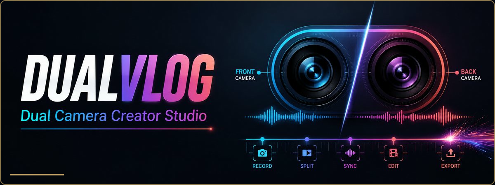

<h1 align="center">DualVlog</h1>

  <strong>Record both sides of the story.</strong> 
  A dual-camera creator studio for recording, editing and publishing social video on iPhone.

  
  
  
  

## Product at a glance

| | |
| --- | --- |
| **Purpose** | Capture the creator and the scene together, then shape both views into one social-ready story. |
| **Audience** | Vloggers, educators, reviewers, podcasters, travellers and property creators. |
| **Core workflow** | Record, select a layout, trim, caption, design a cover and export. |
| **Capture modes** | Dual front/back camera on compatible iPhones, plus focused single-camera capture. |

## Creator workflow

~~~mermaid
flowchart LR
    A[Front + back capture] --> B[Split or PiP layout]
    B --> C[Trim and auto edit]
    C --> D[Teleprompter and captions]
    D --> E[Cover design]
    E --> F[Clean export]
~~~

## Highlights

- Simultaneous front and back camera recording on supported iPhones
- Split-screen, picture-in-picture and creator-focused layouts
- Teleprompter for scripted videos
- Captions powered by Apple speech recognition
- Clip trimming and Smart Auto Edit
- Smart Studio, Social Bundle and Viral Share Kit
- Custom cover design for finished videos
- Clean exports and separate front/back camera files with DualVlog Pro
- 44 supported languages

## Built for

- Vlogs and reaction videos
- Product demonstrations and tutorials
- Podcast and interview clips
- Travel stories
- Property tours
- Fast vertical social content

## Media and privacy

Recordings, photos, generated covers and caption files are created on the device. Camera, microphone, speech recognition and Photos access are requested only when their related features are used.

## Türkçe

DualVlog, desteklenen iPhone modellerinde ön ve arka kamerayı aynı anda kaydederek içerik üreticisini ve sahneyi tek videoda buluşturur. Bölünmüş ekran ve PiP düzenleri; teleprompter, altyazı, kırpma, otomatik düzenleme, kapak tasarımı ve dışa aktarma araçlarıyla tamamlanır.

## Links

- [Download on the App Store](https://apps.apple.com/us/app/dualvlog/id6796005586)
- [Product website](https://sites.google.com/view/dualvlog)
- [Privacy policy](https://sites.google.com/view/dualvlog/privacy)

© 2026 Arda Ozen. All rights reserved.
